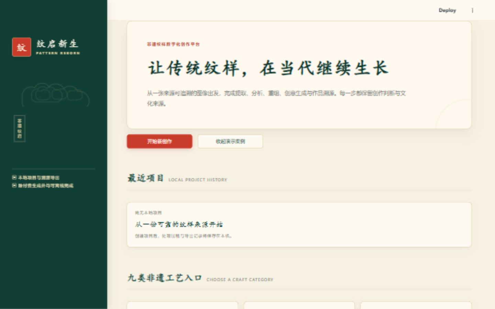
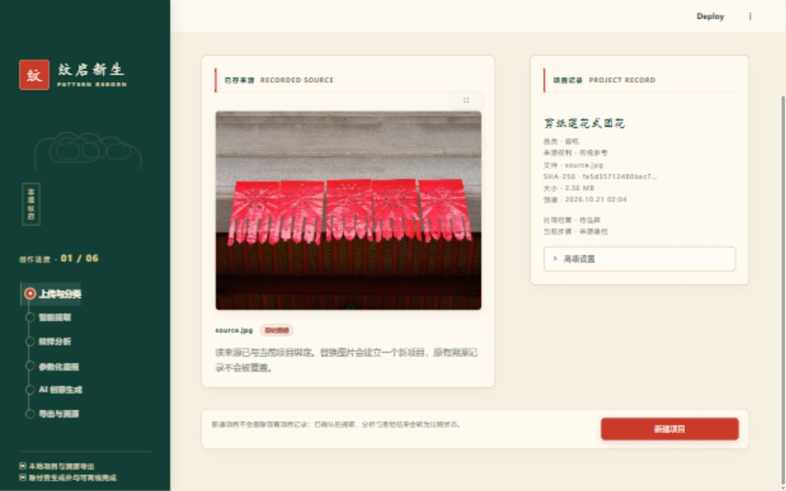
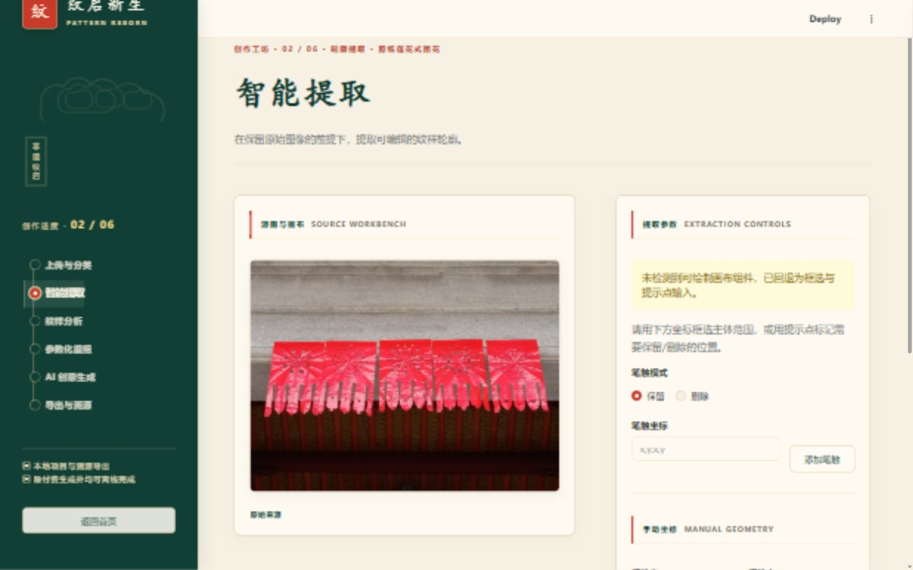

# 产品化现状审查

日期：2026-10-21。结论：先修订产品目标和验收要求，再设计核心工作台，按真实创作路径逐步实现。Python 核心值得复用；比赛导航、视觉规定和固定 UI 测试不宜继续定义正式版。

## 证据范围

阅读 README、CLAUDE、旧规格及项目、流程、UI 代码。在隔离的 `.cache/product-audit-20261021/` 工作目录启动当前应用，用内置浏览器以 1440×900 检查：首页 → 打开内置剪纸示例 → 智能提取。未修改用户原有项目。

只覆盖三个页面；未实际执行提取、走完其余流程、调用付费 API 或重跑全套测试。截图不能证明完整无障碍、算法质量或性能；部分视图处于滚动位置，不是整页截图，也不用于精确字号测量。

## 1. 首页：入口可用，工作内容优先级偏低

优点：品牌、新建、项目和示例入口明确。问题：侧栏装饰、宣传区域和空项目卡占据大部分首屏，作品与分类在下方。建议以项目缩略图、搜索排序和继续编辑为主体，压缩装饰，将示例作为学习入口。浅色小字存在可读性风险，需要实际测量对比度和缩放检查。

## 2. 来源页：记录可见，继续操作不突出

优点：已有来源和原图可见，没有重新显示空上传表单。问题：底部显眼按钮是“新建项目”，继续提取依赖侧栏；底部说明混合新建与结果过期的影响；文件哈希等技术信息占据主面板。建议突出“继续提取”，区分新建、替换来源，并把技术详情折叠。

## 3. 提取页：当前环境的可视化编辑不完整

优点：原图与参数分区、当前步骤和缺依赖状态清楚。问题：当前未安装可绘制画布，需手填笔触和选区坐标；大标题、装饰和面板留白压缩编辑区；参数向下延伸，截图内看不到提取按钮。建议将画布操作纳入标准安装能力，坐标降为高级设置，使用紧凑工具栏与稳定操作区。键盘替代操作和焦点顺序待验证。

## 代码与文档发现

| 发现 | 依据 | 影响 |
| --- | --- | --- |
| 旧目标明确面向比赛，排除更换 Streamlit | `docs/superpowers/specs/2026-08-30-pattern-reborn-hardening-ui-redesign.md` | 需重新定义范围 |
| 样式和测试固定渐变数量、配色、控件索引 | `CLAUDE.md`、`tests/ui/test_theme.py` | 重设计时同步更新测试 |
| 项目管理主要是最近项目入口 | `projects.py`、`ui/home.py` | 需要正式项目库 |
| 有版本文件，但缺少完整历史操作 | `projects.py::confirm`、`ui/steps/recomposition.py` | 需版本选择、比较、恢复；后续结果会被标记过期 |
| 项目格式固定版本 1 | `domain.py::ProjectRecord` | 数据模型扩展需迁移方案 |
| 导出后主要提示磁盘路径 | `ui/steps/export.py` | 在线使用需文件下载交付 |
| 核心服务与界面已有分层 | `workflow.py`、`ui/steps/` | 可保留核心验证新界面 |
| 未发现 `.github/` 工作流目录 | 本次目录检查 | 发布前补持续检查 |

这不是全功能验收。265 项测试通过属于 2026-08-30 历史记录，未作为当前结果引用。

## 文档处理

新增产品基线、路线及本审查；根 README 增加入口；CLAUDE 区分运行现状和未来设计；旧规格、计划、验收仅加历史标记，保留原文。第三方声明、素材授权、来源保护和真实运行要求继续有效。
